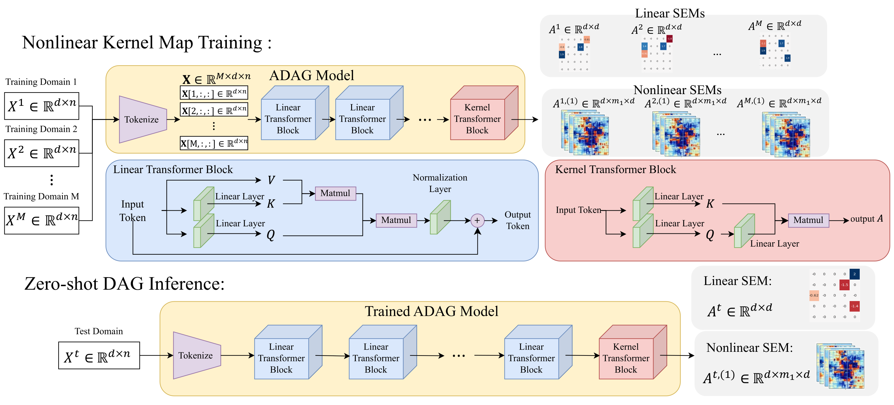

# ADAG: Attention-Based Pretraining for Unsupervised Amortized Causal Discovery

ADAG (Attention-DAG) is a linear-transformer model for *amortized* causal discovery.
Given observations from many domains that follow linear structural equation models (SEMs)
$X = A^\top X + E$, it learns one nonlinear map $A = g(X;\Theta)$ from the observations of
a domain to that domain's weighted adjacency matrix. Training is **unsupervised**: the
model minimises the reconstruction error $`\| X - A(X)^{\top} X \|_F^2`$ over all training
domains under an acyclicity constraint on every $A(X)$, enforced with the augmented
Lagrangian method, so no
ground-truth graphs are needed. Once trained, inference on a new domain is a single forward
pass (about a millisecond), with no per-domain optimisation.

<p align="center">
  
</p>
<p align="center"><em>Training on many domains learns one map from observations to the domain's weighted adjacency matrix (linear SEMs) or first-layer weights (nonlinear SEMs); a trained model infers the DAG of a new domain in one forward pass.</em></p>

This repository contains the reference implementation of

> **Attention-Based Pretraining for Unsupervised Amortized Causal Discovery**
> Naiyu Yin, Tian Gao, Yue Yu. *Advances in Neural Information Processing Systems (NeurIPS), 2026.*

It provides the model, the augmented-Lagrangian trainer, data generation for the three
multi-domain settings of the paper, zero-shot evaluation, a baseline comparison, and a
ready-to-run demo with a trained `d = 5` model. An optional supervised trainer is also
provided. The checkpoints used in the paper are released on Hugging Face at
[fishmoon1234/Attention-Based-DAG-Learning](https://huggingface.co/fishmoon1234/Attention-Based-DAG-Learning).

## Contents

| Path | What it is |
|---|---|
| `adag/model.py` | The ADAG architecture (`ADAG` class): `L` linear-attention layers whose last attention matrix is the weighted adjacency estimate |
| `adag/data.py` | Dataset generation for the `hetero`, `orderconsist` and `general` settings, and the `Shard` loader that synthesises observations on the fly |
| `adag/utils.py` | Acyclicity constraints $h(A)$, relative-error loss, SHD / F1 / AUROC metrics |
| `adag/training.py` | Argument groups, naming and per-epoch monitoring shared by the trainers |
| `generate_data.py` | Command line for data generation |
| `train_adag_alm.py` | **Training with the augmented Lagrangian method (the default)** |
| `train_adag_supervised.py` | Optional supervised variant that uses ground-truth matrices |
| `evaluate_adag.py` | Zero-shot evaluation of a checkpoint on held-out domains |
| `run_baselines.py` | ADAG vs. NOTEARS, DAGMA (and optionally AVICI) on identical data, with a comparison table |
| `demo/` | Trained `d = 5` ADAG model, the matching dataset, the comparison it produces, and `run_demo.sh` |
| `environment.yml`, `requirements.txt` | Conda environment and pip requirements |
| `assets/` | Figures used in this README |

## Installation

```bash
git clone https://github.com/naiyuyin/ADAG.git
cd ADAG
```

The code is also included as the `ADAG/` folder of
[fishmoon1234/Attention-Based-Causal-Discovery](https://github.com/fishmoon1234/Attention-Based-Causal-Discovery);
all commands below are run from inside that folder in either case.

**With conda (recommended):**

```bash
conda env create -f environment.yml
conda activate adag
```

`environment.yml` installs PyTorch with CUDA 12.1; delete the `pytorch-cuda` line for a
CPU-only environment, or pick the CUDA build that matches your driver at
[pytorch.org](https://pytorch.org/get-started/locally/).

**With pip (into an existing environment with PyTorch ≥ 2.1):**

```bash
pip install -r requirements.txt
```

Core dependencies are `torch`, `numpy`, `scipy`, `networkx`, `igraph`, `scikit-learn` and
`tqdm`. The baselines are optional: `dagma` is on PyPI, NOTEARS is installed from
[github.com/xunzheng/notears](https://github.com/xunzheng/notears), and AVICI
(`pip install avici`, pulls in JAX) is only needed for `--methods avici`.

Check the installation with the demo evaluation (a few seconds on a GPU, under a minute on CPU):

```bash
python evaluate_adag.py --ckpt demo/checkpoints/adag_d5_n1000.ckpt \
    --data_root demo/data --level hetero --s0 1 --d 5 --n 1000
```

## Quick start: the demo

`demo/` ships a trained ADAG model and a dataset to evaluate it on:

* `demo/checkpoints/adag_d5_n1000.ckpt` (6.8 MB): a trained ADAG model (`r = 1` head,
  `k = 20`, `L = 35` layers) for `d = 5` variables and `n = 1000` samples per domain.
* `demo/data/hetero/ER1_d5_M101000_seed42/` (1.8 MB): 101 000 heterogeneous domains
  (one ER1 DAG on 5 nodes, edge weights re-drawn per domain), of which the last 1000 are
  the held-out test domains.

`bash demo/run_demo.sh` evaluates the model zero-shot, runs NOTEARS and DAGMA on the
*same* 1000 test domains, and prints the comparison. Results on the 1000 test domains
(mean ± std, edges thresholded at $`|w| \geq 0.3`$):

| Method | SHD ↓ | Edges (5 true) | F1 ↑ | Time / domain ↓ |
|---|---|---|---|---|
| **ADAG** | **0.015 ± 0.137** | **5.00 ± 0.12** | **0.998 ± 0.017** | **1.15 ms** |
| NOTEARS | 0.103 ± 0.500 | 5.01 ± 0.14 | 0.986 ± 0.068 | 271.30 ms |
| DAGMA | 0.039 ± 0.292 | 5.01 ± 0.11 | 0.994 ± 0.041 | 954.19 ms |

ADAG's time is one batched forward pass on an RTX 5090; the baselines' time is a single
CPU core per domain. `run_baselines.py` regenerates these numbers (plus the relative
error of the estimated weights) into `demo/results/comparison_hetero_ER1_d5_n1000_test1000.md`.

## Generating data

`generate_data.py` writes one dataset ("shard") per configuration. The three settings of
the paper are selected with `--level`:

| `--level` | Structure across domains | Reference |
|---|---|---|
| `hetero` | all domains share one DAG, edge weights vary | Lu & Gao (2023) |
| `orderconsist` | all domains share one topological order, edges and weights vary | Chen et al. (2021) |
| `general` | every domain draws an independent random DAG | |

```bash
python generate_data.py --level hetero       --graph_type ER --s0 1 --d 5  --M 101000
python generate_data.py --level orderconsist --graph_type ER --s0 2 --d 20 --M 101000
python generate_data.py --level general      --graph_type ER --s0 4 --d 50 --M 101000
python generate_data.py --level general --d 5 --M 101000 --noise exp     # non-Gaussian noise
```

* Graphs are Erdős–Rényi (`ER`) or scale-free (`SF`) with $`s_0 \cdot d`$ expected edges; edge
  weights are drawn from $U(-2, -0.5) \cup U(0.5, 2)$; the SEM noise is Gaussian by default
  (`exp`, `gumbel`, `uniform` are also available). `ER4` with `d = 5` is impossible
  (20 edges on 5 nodes) and is rejected.
* `--M` is the total number of domains. The trainers and evaluator always hold out the
  **last 1000** (`--n_test`) as test domains, so `--M 101000` gives the paper's
  100 000 training + 1000 test split.
* Only the weighted adjacency matrices are stored (sparse, float32, `manifest.json` +
  `W.npz`, a few MB per configuration). Observations are synthesised when a batch is
  loaded from the closed form $X = Z\,(I - W)^{-1}$ with a seeded noise draw, so the per-domain
  sample size `n` is chosen at training / evaluation time, not at generation time, and the
  same shard serves every `n`. See `adag/data.py`.
* Output goes to `data/{level}/{graph_type}{s0}_d{d}_M{M}_seed{seed}/`; point the other
  scripts at it with the same `--data_root --level --graph_type --s0 --d --M --data_seed`.

## Training ADAG

### Augmented Lagrangian training (default)

```bash
python train_adag_alm.py --data_root data --level general --graph_type ER --s0 1 --d 5 \
    --n 1000 --M_train 100000
```

This runs Algorithm 1 of the paper:

1. **Warm-up** at fixed multipliers $\alpha = 0,\ \rho = 1$ for `--warmup_epochs` (5000) epochs,
   learning rate `3e-4` decayed by `0.7` every `1000` epochs (`--lr --gamma --step_size`).
2. **Augmented Lagrangian loop**: repeat `--inner_epochs` (100) epochs at `--inner_lr`
   (`1e-4`); if the mean acyclicity violation $h(A)$ on the training domains did not fall to
   `--c` ($\tfrac14$) of its previous value, multiply $\rho$ by 10 and repeat; then
   $\alpha \leftarrow \alpha + \rho\, h$.
   Stop when `h < --h_tol` (`1e-5`) or after `--max_outer` iterations.

The objective over a batch of $B$ domains is

```math
\mathcal{L}(\Theta) = \frac{1}{B}\sum_{\eta=1}^{B} \left[ \frac{1}{2n} \left\| A(X^{\eta}) X^{\eta} - X^{\eta} \right\|_F^2 + \alpha \, h\!\left(A(X^{\eta})\right) + \frac{\rho}{2} \, h\!\left(A(X^{\eta})\right)^2 + \lambda_1 \left\| A(X^{\eta}) \right\|_1 \right]
```

```math
h(A) = \mathrm{tr}\!\left[ \left( I + \frac{A \circ A}{d} \right)^{d} \right] - d
```

where $h(A) = 0$ if and only if $A$ is acyclic (`--acyclicity logdet` switches to the DAGMA
form $`h(A) = -\log\det(sI - A \circ A) + d \log s`$) and $`\lambda_1`$ is `--lamb_l1`
(0.02). No ground-truth graph enters the objective; the
relative error of `A` that is printed each epoch is for monitoring only.

### Checkpoints

Both trainers write to `--out_dir` (default `checkpoints/`) under one name built from the
data and architecture arguments,

```
{name} = adag_{level}_{graph_type}{s0}_d{d}_n{n}_M{M_train}_L{n_layers}_k{dk}_r{n_heads}_seed{seed}
```

(or `--name`): `{name}.ckpt` is the trained model (the iterate selected by `--select_by`
on the test domains), `{name}_last.ckpt` the last iterate, `{name}_init.ckpt` the
initialisation and `{name}_log.csv` the per-epoch curves. The augmented-Lagrangian
trainer additionally saves `{name}_warmup.ckpt` at the end of the warm-up, and
`--stage warmup` / `--stage alm --init_ckpt …` run its two stages separately. Every
checkpoint is a plain `state_dict` of the `ADAG` class and is evaluated with the same
`evaluate_adag.py` command.

### Supervised variant (optional)

```bash
python train_adag_supervised.py --data_root data --level hetero --s0 1 --d 5 --n 1000 \
    --M_train 100000 --epochs 1000
```

Minimises, against the ground-truth matrices $W^\eta$ of the training domains,

```math
\mathcal{L}(\Theta) = \frac{1}{B}\sum_{\eta=1}^{B} \left[ \frac{ \left\| A(X^{\eta})^{\top} - W^{\eta} \right\|_F }{ \left\| W^{\eta} \right\|_F } + \lambda_{\mathrm{rec}} \, \frac{1}{2n} \left\| A(X^{\eta}) X^{\eta} - X^{\eta} \right\|_F^2 \right]
```

with $`\lambda_{\mathrm{rec}}`$ = `--lamb_rec` (1), optionally plus the acyclicity penalty
(`--alpha --rho`),
with the same data pipeline, checkpoint names and evaluation as above.

### Practical notes

* Defaults are the paper's: `--n_heads 1 --dk 20 --n_layers 35 --batch_size 100`, Adam
  with weight decay `1e-6`. Per-epoch monitoring uses the first `--eval_train_domains`
  (1000) training domains and all test domains.
* From a random initialisation the first epochs show very large $h(A)$ and
  reconstruction values (the untrained attention output is far from a sparse DAG); they
  shrink by orders of magnitude within the first few thousand optimiser steps. This is
  expected.
* A trained model is tied to the `n` it was trained with ($`W^Q, W^K \in \mathbb{R}^{n \times k}`$). To apply it
  to domains with fewer samples, `evaluate_adag.py --resample_to_n n_available` pads each
  domain to `n` by resampling its observations with replacement (paper, Appendix A).
* `--resample_noise` draws fresh observations from the same SEMs every epoch instead of a
  fixed dataset; `--M_train` controls the number of training domains (paper ablation:
  ≥ 70 000 for `d = 5`).
* On an RTX 5090 one epoch over 100 000 domains at `d = 5, n = 1000` takes about 13 s.

## Evaluating a trained model

The ADAG checkpoints evaluated in the paper are available on Hugging Face:
[huggingface.co/fishmoon1234/Attention-Based-DAG-Learning](https://huggingface.co/fishmoon1234/Attention-Based-DAG-Learning).
Each is a plain `state_dict` of the `ADAG` class and is evaluated with the command below,
with `--d --n --n_layers --dk --n_heads` set to the values the checkpoint was trained with.
The demo checkpoint in `demo/checkpoints/` is one of them.

```bash
python evaluate_adag.py --ckpt checkpoints/<name>.ckpt \
    --data_root data --level general --s0 1 --d 5 --n 1000 --out_dir results/adag
```

Applies the model once to each of the held-out domains and reports, per domain and on
average, SHD, number of edges, precision, recall, F1, AUROC and the relative error of the
weights, at the standard threshold $`|w| \geq 0.3`$ (`--w_threshold`). The architecture flags
must match the checkpoint. Outputs: `A_est_*.npy` (raw estimates), `metrics_*.csv`,
`summary_*.json`.

## Baselines

```bash
python run_baselines.py --methods adag notears dagma --ckpt <checkpoint> \
    --data_root data --level general --s0 1 --d 5 --n 1000
```

Every method is scored on exactly the same observations with the same metric code, so the
rows are comparable: ADAG (zero-shot, GPU), NOTEARS and DAGMA (linear, L2 loss,
`--lambda1 0.02`, one CPU process per domain), and AVICI (pretrained `scm-v0`, edge
probabilities cut at 0.5). `--limit K` tries the first `K` test domains.

## Conventions worth knowing

* `ADAG.forward(x)` takes `x` of shape `[batch, d, n]` (variables as tokens) and returns
  `(x_hat, A)` with `x_hat = A x`. `A[i, j]` is the weight of `j → i`; every script
  converts to the NOTEARS / DAGMA convention $`W = A^{\top}`$ ($`W_{ij} \neq 0 \Leftrightarrow i \to j`$) before
  comparing with the ground truth. `ADAG.estimate(x)` returns `W` directly.
* Checkpoints are plain `state_dict`s loadable with `ADAG.from_checkpoint`. Parameters are
  `fcq` / `fck` (query / key maps), `fcn` (layer norms) and `fcpx` (a per-head output
  projection registered for checkpoint compatibility; not applied in the forward pass).
* Datasets are reproducible from their `manifest.json`; `Shard(path, n).batch(idx)` returns
  `(X [B, n, d], W [B, d, d])`.

## Citation

```bibtex
@inproceedings{yin2026adag,
  title     = {Attention-Based Pretraining for Unsupervised Amortized Causal Discovery},
  author    = {Yin, Naiyu and Gao, Tian and Yu, Yue},
  booktitle = {Advances in Neural Information Processing Systems (NeurIPS)},
  year      = {2026}
}
```

Code: [github.com/naiyuyin/ADAG](https://github.com/naiyuyin/ADAG) ·
Checkpoints: [huggingface.co/fishmoon1234/Attention-Based-DAG-Learning](https://huggingface.co/fishmoon1234/Attention-Based-DAG-Learning)
